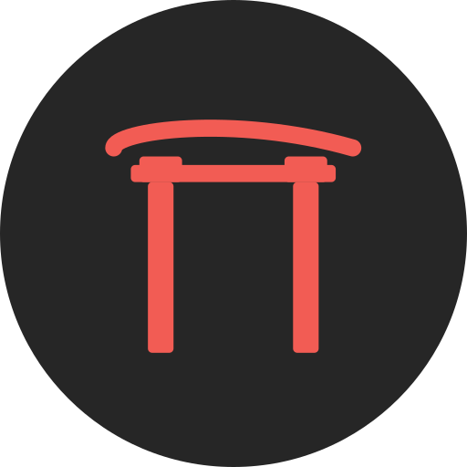
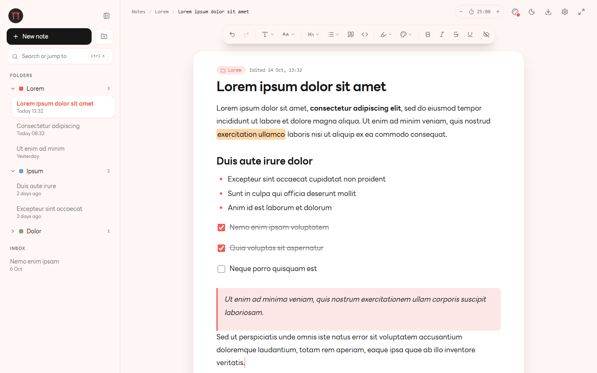

<p align="center">
  
</p>

<h1 align="center">Raku 楽</h1>

<p align="center">
  A fast, distraction-free note-taking app for Windows.<br>
  No accounts. No cloud. Just write.
</p>

<p align="center">
  <a href="https://github.com/snui1s/Raku/releases/latest"><b>Download</b></a> ·
  <a href="https://raku.snui1s.com">Website</a> ·
  <a href="https://raku.snui1s.com/docs/">Docs</a>
</p>

<p align="center">
  
</p>

## Features

- **Local first:** notes, folders and images stay on your computer, with no account and no telemetry
- **Open source:** [MIT licensed](LICENSE); release installers are built from this repository by a public GitHub Actions workflow
- **Small:** the installer is about 5 MB, and the app uses about 170 MB of memory when idle (WebView2 included)
- **Rich text:** headings, lists, checklists, quotes, highlights, fonts and colors
- **Folders:** organize notes and move them with drag and drop
- **Quick search:** `Ctrl K` jumps to any note
- **Zoom and settings:** `Ctrl` + scroll zooms the paper; width, line spacing and interface scale are adjustable
- **Themes:** light and dark, with 8 color palettes
- **Export and backup:** Markdown, PDF, and full backup and restore
- **Focus tools:** zen mode and a Pomodoro timer
- **Auto-update:** new versions install from within the app

Measured on a Core Ultra 7 laptop with 32 GB RAM: the window appears in under 0.1 s and the app finishes starting in about 2 s. See [bench/](bench/README.md) to measure your own machine.

## Development

Requires [Bun](https://bun.sh) and the [Tauri prerequisites](https://tauri.app/start/prerequisites/).

```bash
bun install
bun run tauri dev     # run the app
bun run test          # unit tests
bun run tauri build   # build the installer
```

Built with [Tauri](https://tauri.app), React, [Tiptap](https://tiptap.dev) and SQLite.

### Website

The site at [raku.snui1s.com](https://raku.snui1s.com) (the home page, the docs and the privacy policy) lives in [website/](website/README.md). It is a separate project with its own `package.json`, built with Astro and Three.js and deployed on Vercel.

```bash
cd website
bun install
bun run dev           # local dev server
bun run test          # unit tests
bun run build         # production build into dist/
```

## Releases

Run the **Release** workflow from the Actions tab (patch, minor or major). It bumps the version, tests, builds, signs the update with the updater key, publishes the installer and updates `update.json` for the in-app updater. The website reads the same file for the version and the installer link on its download button.

## Installer signing

The Windows installer is **not signed with a Windows (Authenticode) certificate**. Free code signing through the [SignPath Foundation](https://signpath.org/) was not granted, and Raku does not use a paid certificate for now. Because of this, Windows SmartScreen may show "Windows protected your PC" the first time you run the installer. If you downloaded it from the [official release](https://github.com/snui1s/Raku/releases/latest), click **More info**, then **Run anyway**.

What you can check instead:

- **Where it comes from:** release installers are built from this repository by the public GitHub Actions workflow in [`.github/workflows/release.yml`](.github/workflows/release.yml), which runs typecheck and tests before it builds.
- **That the file is the one that was built:** every release has a `SHA256SUMS` file. See [Verify your download](https://raku.snui1s.com/docs/getting-started/#verify-your-download).
- **In-app updates:** Raku checks the `.sig` signature of an update against the public key in `src-tauri/tauri.conf.json` before it installs it. This is Tauri's updater signature, a different thing from a Windows publisher signature.
- **The source:** the whole app is here under the [MIT license](LICENSE).

Code signing may be added later; this section will say so when it is.

## Privacy policy

Raku does not collect, transmit or sell any personal data. There are no accounts and no telemetry.

- Your notes, folders and images are stored only on your computer (SQLite database and image folder in the app data directory).
- The app makes these network requests: checking `update.json` on GitHub for new versions (and downloading an update only when you accept it), and loading web fonts from Google Fonts and jsDelivr when you are online and use a font that is not bundled. Those services can see your IP address as for any web request.
- Backups are files you create and keep yourself.

## License

[MIT](LICENSE)
